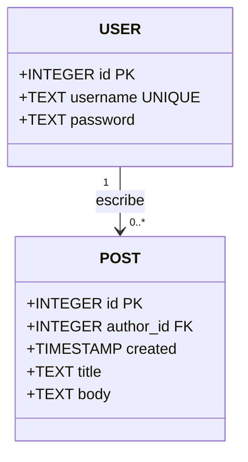

# Diagrama de clases

## Objetivo
Este archivo muestra con un dibujo cómo se guardan los datos de la aplicación. Hay dos partes: usuarios (USER) y publicaciones (POST). Un usuario puede escribir muchas publicaciones.

